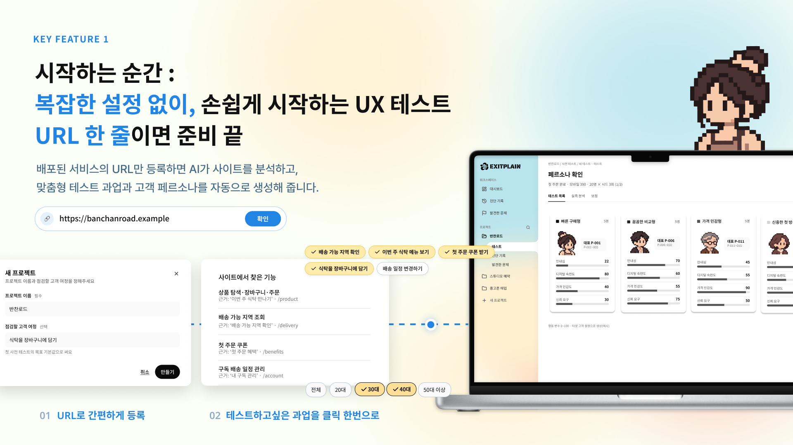
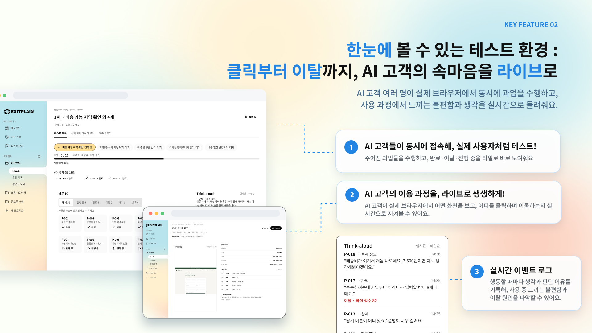
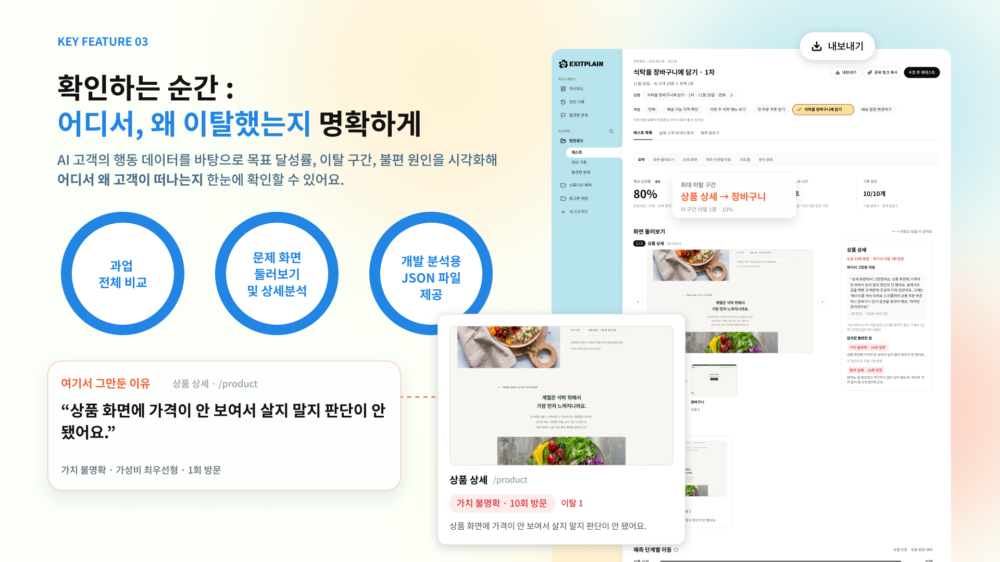
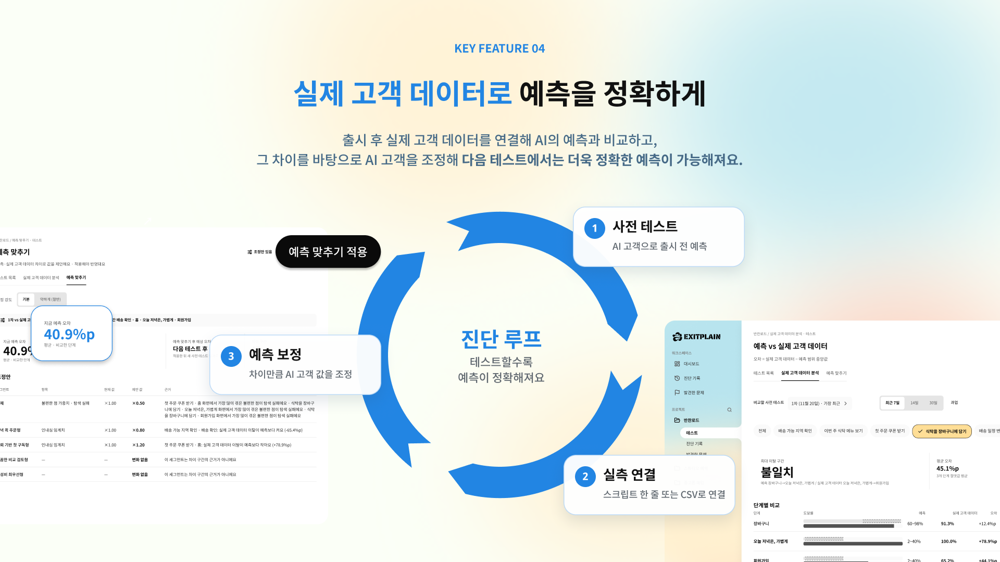

# Exitplain FE

> **AI 페르소나가 실제 브라우저로 사이트를 써 보고, 어디서 왜 이탈하는지 알려 주는 UX 점검 서비스**의 프론트엔드 저장소입니다.

[문서 목록](docs/README.md) · [협업 규칙](CONTRIBUTING.md) · 백엔드·AI 에이전트: [Exitplain/BE](https://github.com/Exitplain/BE)

<br>

## 🖥️ 서비스 소개

<p align="center">
  
  
  
  
</p>

<br>

## 💡 팀원 소개

<table>
  <tr>
    <td align="center" width="130"><b>장서후</b></td>
    <td align="center" width="130"><b>고명준</b></td>
    <td align="center" width="130"><b>이정능</b></td>
    <td align="center" width="130"><b>심재현</b></td>
    <td align="center" width="130"><b>이정은</b></td>
    <td align="center" width="130"><b>정혜원</b></td>
  </tr>
  <tr>
    <td align="center"></td>
    <td align="center"></td>
    <td align="center"></td>
    <td align="center"></td>
    <td align="center"></td>
    <td align="center"></td>
  </tr>
  <tr>
    <td align="center">기획·디자인</td>
    <td align="center">프론트엔드</td>
    <td align="center">프론트엔드</td>
    <td align="center">기획·AI</td>
    <td align="center">백엔드</td>
    <td align="center">백엔드</td>
  </tr>
  <tr>
    <td align="center"><a href="https://github.com/SoWho-J">@SoWho-J</a></td>
    <td align="center"><a href="https://github.com/kmj0973">@kmj0973</a></td>
    <td align="center"><a href="https://github.com/jeongneung">@jeongneung</a></td>
    <td align="center"><a href="https://github.com/Jaehyeon-kr">@Jaehyeon-kr</a></td>
    <td align="center"><a href="https://github.com/abdc5307">@abdc5307</a></td>
    <td align="center"><a href="https://github.com/HyewonC80">@HyewonC80</a></td>
  </tr>
</table>

<br>

## ✨ 주요 기능

1. **사이트 확인** — URL(또는 공개 git 저장소의 정적 사이트 코드)을 받아 둘러보고, 확인할 과업 후보를 제안
2. **계획 확정** — 과업·타겟 고객·연령대·세그먼트 인원을 정하고 확정하면, 그 기준으로 페르소나를 생성
3. **실행** — 페르소나마다 독립된 브라우저로 과업을 수행하고, 진행·발화·화면을 실시간으로 수집
4. **리포트** — 단계별 이동(퍼널), 이탈 원인 Top 3, 세그먼트 × 단계 히트맵, 근거 스크린샷, 방문별 종료 설명, Markdown·PDF 내보내기
5. **실측 · 보정** — 실제 고객 데이터(수집 스크립트·CSV)를 모아 예측과 비교하고, 페르소나 수치를 보정

<br>

## 🛠️ 기술 스택

**Core** &nbsp;


**Data · State** &nbsp;


**Test · Quality** &nbsp;


**Deploy · CI** &nbsp;


<br>

| 구분 | 기술 |
|---|---|
| Language / UI | React 19 + TypeScript |
| Build | Vite — 개발 서버·빌드 |
| Styling | Tailwind CSS |
| Routing | React Router — 페이지 라우팅 |
| Server State | TanStack Query — 서버 데이터 조회·캐싱 |
| Client State | Zustand — 클라이언트 상태 관리 |
| API | Axios — API 통신 |
| Chart | Recharts — 차트 시각화 |
| Test | Vitest + React Testing Library |
| Mock | MSW — API 모킹 (BE 없이 화면 개발·테스트) |
| Code Quality | ESLint + Prettier — 코드 품질·포맷 관리 |
| CI | GitHub Actions — lint · format · test · build 자동 검사 |
| Deploy | Vercel |

<br>

## 📁 저장소 구조

```
FE/
├── web/                 # React 앱 (Exitplain 서비스 화면)
│   └── src/
│       ├── pages/       #   화면 (대시보드, 새 테스트, 실행, 리포트, 실측 분석, 예측 맞추기 …)
│       ├── components/  #   공통 컴포넌트
│       ├── apis/        #   API 호출 (Axios)
│       ├── hooks/       #   TanStack Query 훅
│       ├── stores/      #   Zustand 상태
│       ├── mocks/       #   MSW 핸들러·목데이터
│       └── types/       #   API 타입
├── demo-shop/           # 페르소나 실행 대상 데모 쇼핑몰 (반찬로드, 합성 데이터)
├── saas-web/            # 이전 HTML/JS 화면 (BE 개발 서버용, 유지)
└── docs/                # API 명세 사본, Figma 반영 내역, 개발 가이드
```

<br>

## 🚀 로컬 실행

```bash
git clone https://github.com/Exitplain/FE.git
cd FE/web
npm install
cp .env.example .env.local   # API 프록시 주소 등 설정

npm run dev        # http://localhost:5173 (/api 는 BE로 프록시)
npm run dev:mock   # BE 없이 MSW mock으로 실행
```

<br>

## ✅ 검사

```bash
cd web
npm run lint
npm run format:check
npm run test:run
npm run build
```

GitHub Actions(`web-ci.yml`)가 `web/` 이 바뀐 PR과 main·develop 푸시마다 같은 검사를 실행합니다.

